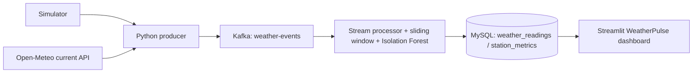

# WeatherPulse

WeatherPulse is an academic streaming analytics demo for weather observations. It sends simulated sensor events or Open-Meteo current conditions through Kafka, calculates per-station rolling metrics, scores events with an Isolation Forest, stores them in MySQL, and displays pipeline freshness and trends in Streamlit.

## Architecture



Open-Meteo is requested for one Bengaluru point (12.9716, 77.5946), with an initial polling interval of five minutes. These values are API estimates, not necessarily direct physical-station observations. The current endpoint provides one vector here; WeatherPulse does not invent a citywide wind field or show streamlines without spatial measurements. The simulator stays available as a separate source.

The Bengaluru wind panel has a **Play flow** animation. In simulator mode, the latest processed BLR event's simulated wind speed and gradually changing wind direction set the particle speed and heading. In Open-Meteo mode, the same visualization uses the current API sample. Particle tracks are explicitly illustrative uniform-flow paths around that one sample; they are not observed streamlines or citywide measurements. The color scale reflects the sampled wind speed.

## Local setup

1. Install Python 3.12 and Docker Desktop.
2. Create the environment and install dependencies:

   ```powershell
   py -3.12 -m venv .venv
   .\.venv\Scripts\Activate.ps1
   python -m pip install -r requirements.txt
   if (-not (Test-Path .env)) { Copy-Item .env.example .env }
   ```

3. Edit `.env` and choose unique local MySQL passwords. Keep `.env` private; it is ignored by Git.
4. Start Docker services with `docker compose up -d`. Compose initializes Kafka topic `weather-events` and MySQL tables. Existing named volumes are preserved.
5. In separate project terminals, run:

   ```powershell
   .\.venv\Scripts\python.exe -m src.producer
   .\.venv\Scripts\python.exe -m src.stream_processor
   .\.venv\Scripts\python.exe -m streamlit run src/dashboard.py --server.port 8503
   ```

   Open http://localhost:8503.

## One-click Windows start

Run `WeatherPulse.ps1` from File Explorer (right-click **Run with PowerShell**) or a terminal. The existing shortcut entry point and `.bat` file both forward to this script:

```powershell
powershell.exe -NoProfile -ExecutionPolicy Bypass -File "C:\Users\kuruv\weather-streaming\WeatherPulse.ps1"
```

Optional desktop shortcut target:

```text
powershell.exe -NoProfile -ExecutionPolicy Bypass -File "C:\Users\kuruv\weather-streaming\WeatherPulse.ps1"
```

The launcher waits for Kafka and MySQL, reuses project producer/processor/dashboard processes, and opens the browser when Streamlit responds. To stop, close the visible Python/Streamlit terminals and run `docker compose stop`; this preserves volumes and database data. Launcher diagnostics are appended to `weatherpulse-startup.log`.

## Configuration

Set values in `.env` before starting the processes:

| Variable | Default | Meaning |
|---|---:|---|
| `WEATHER_SOURCE` | `simulated` | `simulated` or `open_meteo` producer input |
| `SENSOR_INTERVAL_SECONDS` | `2` | Simulator interval |
| `OPEN_METEO_INTERVAL_SECONDS` | `300` | Live API polling interval; minimum 60 seconds |
| `DASHBOARD_REFRESH_SECONDS` | `15` | Streamlit rerun interval |
| `KAFKA_BOOTSTRAP_SERVERS` | `localhost:9092` | Host-side Kafka address |
| `MYSQL_HOST` / `MYSQL_PORT` | `127.0.0.1` / `3308` | Host-side MySQL address |
| `MYSQL_DATABASE`, `MYSQL_USER`, `MYSQL_PASSWORD` | Compose defaults | MySQL connection settings |

Use `WEATHER_SOURCE=open_meteo` to publish one current Bengaluru event on each API polling cycle. The same observation timestamp produces the same event ID, so repeat polls do not inflate saved totals. API failures are logged and retried with a delay. Simulator events retain independent event IDs and can inject optional scenarios using `SCENARIO=heatwave`, `storm_gust`, or `humidity_fault`.

## Model

The checked-in `models/isolation_forest.joblib` is a plain scikit-learn Isolation Forest with three ordered inputs: temperature °C, relative humidity %, and wind speed km/h. Train a replacement with `python -m src.train_model`; evaluate against labelled synthetic examples with `python -m src.evaluate_model`. Reported evaluation is synthetic and does not establish real-world weather-warning validity. An anomaly is an unusual model input, not an official weather alert.

## Troubleshooting

- **Kafka not ready:** run `docker compose ps` and `docker compose logs kafka kafka-init`. Host Python uses `localhost:9092`; containers use `kafka:29092`.
- **MySQL unavailable:** run `docker compose logs mysql`, verify `MYSQL_*` values, and check port 3308 is free. The application adds source/timestamp columns using a non-destructive additive migration.
- **No recent readings / stale status:** confirm the producer and processor terminals are running; verify Kafka topic and MySQL connectivity. The dashboard measures successful insert time, not merely whether Streamlit is open.
- **Open-Meteo outage:** producer logs the error and retries; dashboard shows an error state rather than fabricated readings. API requests are cached in the dashboard for 5 minutes.
- **Port 8503 occupied:** stop the other process or change the launcher and Streamlit port consistently.
- **Launcher failure:** inspect `weatherpulse-startup.log` and Docker service logs.

## Limitations

Kafka and MySQL use local development networking and plaintext protocols; do not expose these ports publicly. Model training and the demo simulator use synthetic distributions. Open-Meteo may provide forecast/model-derived current estimates rather than station observations. Streamline and radar products are not provided. End-to-end operation requires Docker Desktop, local dependencies, and valid `.env` values.

## Production deployment

This repository is a Streamlit application backed by long-running Kafka and MySQL services. It is not directly deployable as a production Vercel app: Vercel's Python runtime is for request-based Functions, and Vercel Functions cannot act as WebSocket servers for Streamlit's interactive server. Keep the producer, Kafka, stream processor, and MySQL on a suitable always-on backend host. A Vercel deployment would require a separate web frontend plus a secured, public API connected to that backend. Do not expose the local MySQL or Kafka ports to make the dashboard reachable. No Vercel project is linked in this checkout.
