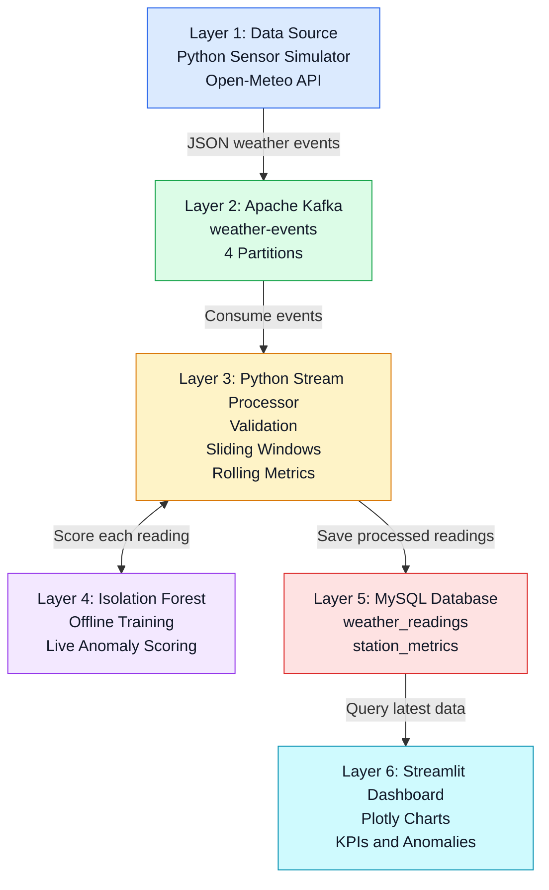

# WeatherPulse: Real-Time Weather Sensor Monitoring

### Real-Time Data Streaming, Anomaly Detection, and Interactive Visualization

WeatherPulse is a real-time weather monitoring system that combines streaming analytics and machine learning to process weather readings, identify unusual sensor observations, and display live weather metrics through an interactive dashboard.

The project implements an end-to-end streaming pipeline using **Apache Kafka, Python, scikit-learn, MySQL, Streamlit, and Plotly**. It supports simulated weather sensors and the Open-Meteo API, processes incoming events continuously, and detects potential anomalies using an unsupervised Isolation Forest model.

> **Project:** WeatherPulse — Real-Time Weather Sensor Monitoring  
> **Course:** Data Stream Analytics  
> **Platform:** Windows with Docker Desktop  
> **Project Type:** Academic Mini Project

---

## Table of Contents

- [Overview](#overview)
- [Key Features](#key-features)
- [System Architecture](#system-architecture)
- [Technology Stack](#technology-stack)
- [Data Sources](#data-sources)
- [How the System Works](#how-the-system-works)
- [Machine Learning and Anomaly Detection](#machine-learning-and-anomaly-detection)
- [Database Design](#database-design)
- [Dashboard and Visualization](#dashboard-and-visualization)
- [Project Structure](#project-structure)
- [Prerequisites](#prerequisites)
- [Installation and Setup](#installation-and-setup)
- [Running the Application](#running-the-application)
- [Injecting Anomalies](#injecting-anomalies)
- [Results and Observations](#results-and-observations)
- [Testing](#testing)
- [Limitations](#limitations)
- [Future Enhancements](#future-enhancements)
- [Team Members](#team-members)

---

## Overview

Weather data is continuously generated, and identifying unusual conditions requires more than periodically collecting information in a database. A monitoring system must process incoming readings, maintain recent measurements, identify potential anomalies, and make the results available for analysis.

WeatherPulse addresses this requirement through a streaming architecture in which simulated or API-based weather observations flow through Apache Kafka to a Python stream processor.

The processor validates incoming events, maintains sliding windows for individual weather stations, calculates rolling metrics, and scores readings using a trained Isolation Forest model. The processed information is stored in MySQL and presented through a Streamlit dashboard that refreshes automatically.

The system monitors four Indian cities:

- Bengaluru
- Mumbai
- Delhi
- Chennai

WeatherPulse also supports controlled anomaly scenarios, including simulated heatwaves, storm gusts, and humidity sensor faults, to demonstrate how unusual readings are handled by the pipeline.

### Project Objectives

- Build an end-to-end real-time data streaming pipeline.
- Demonstrate Apache Kafka as a distributed messaging system.
- Process incoming weather events using sliding windows.
- Apply unsupervised machine learning for anomaly detection.
- Store processed readings and station-level metrics in MySQL.
- Visualize weather measurements using Streamlit and Plotly.
- Handle duplicate events safely and monitor data freshness.
- Demonstrate how model thresholds affect anomaly detection.

---

## Key Features

- **Real-Time Data Streaming:** Uses Apache Kafka to transfer weather events from the producer to the stream processor.
- **Multiple Data Sources:** Supports a Python-based sensor simulator and current weather observations from Open-Meteo.
- **Windowed Stream Processing:** Maintains a separate sliding window containing the latest 10 valid readings for each station.
- **Machine Learning-Based Anomaly Detection:** Uses Isolation Forest to identify unusual combinations of temperature, humidity, and wind speed.
- **Weather Metrics:** Calculates rolling averages, peak temperature, peak wind speed, and heat index.
- **Persistent Storage:** Stores weather readings and station summaries in MySQL.
- **Interactive Dashboard:** Displays key performance indicators, weather trends, station information, and detected anomalies.
- **Automatic Refresh:** Periodically re-queries MySQL to display updated information.
- **Duplicate-Safe Processing:** Uses unique event identifiers and duplicate-safe database writes to prevent replayed events from inflating station counts.
- **Data Freshness Monitoring:** Indicates when incoming data becomes stale because the producer or processor has stopped.

---

## System Architecture

WeatherPulse follows the six-layer architecture specified in the project guide.

### Architecture Diagram



### Architecture Layers

| Layer | Component | Responsibility |
|---|---|---|
| 1. Data Source | Python simulator / Open-Meteo | Generates or retrieves weather readings. |
| 2. Streaming Tool | Apache Kafka | Transfers events through the `weather-events` topic. |
| 3. Stream Processor | Python | Validates events, maintains sliding windows, and calculates rolling metrics. |
| 4. Machine Learning | Isolation Forest | Scores readings and identifies potential anomalies. |
| 5. Storage | MySQL 8.4 | Stores readings and station-level summaries. |
| 6. Visualization | Streamlit and Plotly | Displays weather metrics, trends, anomalies, and pipeline status. |

### Data Flow

1. The sensor simulator or Open-Meteo producer generates a weather event.
2. The producer publishes the event to Kafka using the station ID as its message key.
3. The Python stream processor consumes and validates the event.
4. Valid readings update the station's sliding window and rolling metrics.
5. The Isolation Forest model scores each eligible reading.
6. The processor writes the processed event to MySQL.
7. Station-level metrics are updated when a new event is inserted.
8. The Streamlit dashboard queries MySQL and refreshes its visualizations automatically.

---

## Technology Stack

| Technology | Purpose |
|---|---|
| Python | Data generation, streaming, processing, and application logic |
| Apache Kafka 3.9 | Real-time event streaming |
| Docker Desktop | Running Kafka and MySQL containers |
| MySQL 8.4 | Persistent storage and serving layer |
| scikit-learn | Machine learning and anomaly detection |
| Isolation Forest | Unsupervised anomaly detection |
| Pandas and NumPy | Data handling and numerical operations, where used |
| Streamlit | Interactive dashboard |
| Plotly | Charts and weather visualizations |
| kafka-python | Kafka producer and consumer integration |
| joblib | Saving and loading the trained model |
| pytest | Automated testing |

---

## Data Sources

WeatherPulse supports two data source configurations.

### 1. Simulated Weather Data

The Python sensor simulator generates weather readings for all four stations.

Each station maintains its own simulated state. Consecutive readings change gradually to approximate normal sensor observations.

| Parameter | Configuration |
|---|---|
| Stations | BLR, MUM, DEL, CHE |
| Temperature range | 22–36 °C |
| Humidity range | 30–90% |
| Wind speed range | 0–30 km/h |
| Default sensor interval | 2 seconds |

The simulator can inject predefined anomaly scenarios to test the pipeline.

### 2. Open-Meteo API

WeatherPulse can also retrieve current weather observations from Open-Meteo.

The documented API configuration uses Bengaluru coordinates and polls observations at a default interval of 300 seconds.

These are model-derived weather estimates, not measurements from a physical weather station.

The same event schema is used for both data sources so that the downstream streaming pipeline can process them consistently.

### Weather Event Schema

Each event contains fields similar to the following:

```json
{
  "event_id": "example-event-uuid",
  "station_id": "BLR",
  "station_name": "Bengaluru",
  "event_timestamp": "2026-10-29T17:01:03.912+00:00",
  "temperature_c": 23.09,
  "humidity_pct": 41.39,
  "wind_speed_kmh": 10.47,
  "wind_direction_deg": 34.0,
  "source_type": "simulated",
  "scenario": null,
  "is_simulated": true
}
```

*The values above illustrate the event format and are not intended to represent a current weather observation.*

---

## How the System Works

### 1. Kafka Producer

The producer generates weather events and publishes them to the Kafka topic `weather-events`.

The topic is configured with four partitions. Messages use the station ID as the Kafka key. This ensures that messages for the same station are assigned to the same partition, preserving partition-level ordering while allowing different stations to be processed in parallel.

The producer also uses acknowledgement and retry settings to improve message-delivery reliability.

### 2. Stream Processor

The Python stream processor consumes events from Kafka and performs the following operations:

- Validates incoming events.
- Checks required fields and numeric values.
- Rejects invalid timestamps and negative wind speeds.
- Handles invalid humidity values as sensor faults.
- Maintains a sliding window of the latest 10 valid readings per station.
- Calculates rolling weather metrics.
- Scores eligible readings with the Isolation Forest model.
- Saves processed results to MySQL.

A Python `deque` with a maximum length of 10 maintains the sliding window. When a new reading arrives, the oldest reading is automatically removed if the window is full.

### 3. Reliability and Duplicate Handling

WeatherPulse uses at-least-once message delivery with duplicate-safe database writes.

Because an event can be consumed again after a restart or replay, each reading has a unique `event_id`. MySQL enforces uniqueness on this identifier, preventing duplicate events from being counted as new readings.

The station summary is updated only when a new event is successfully inserted.

### 4. Live Visualization

The dashboard reads from MySQL rather than consuming Kafka messages directly.

It queries the latest readings and station metrics, renders the visualizations, waits for the configured refresh interval, and reruns the Streamlit application.

The pipeline status is based on the timestamp of the last successful database insertion. If the producer or processor stops, the dashboard can continue refreshing while showing stale data.

---

## Machine Learning and Anomaly Detection

WeatherPulse uses **Isolation Forest**, an unsupervised anomaly detection algorithm from scikit-learn.

Unlike supervised classification, the model does not require labelled anomalies during training. It learns patterns in the training data and identifies observations that are easier to isolate from the rest.

### Model Inputs

The model uses three features:

1. Temperature in degrees Celsius.
2. Relative humidity in percentage.
3. Wind speed in kilometres per hour.

### Training Configuration

According to the project implementation, the model is trained offline using 20,000 synthetic normal readings.

| Parameter | Configuration |
|---|---|
| Algorithm | Isolation Forest |
| Training samples | 20,000 synthetic normal readings |
| Number of estimators | 200 |
| Contamination | 0.03 |
| Random state | 42 |
| Model persistence | joblib |
| Training script | `src/train_model.py` |
| Saved model | `models/isolation_forest.joblib` |

The trained model is saved and loaded by the stream processor at startup. Each eligible incoming reading is scored using the saved model instead of retraining the model continuously.

### Anomaly Scenarios

| Scenario | Simulated condition |
|---|---|
| Heatwave | Temperature between 40 and 46 °C |
| Storm gust | Wind speed between 75 and 120 km/h |
| Humidity fault | Humidity below 0% or above 100% |

Humidity sensor faults are explicitly identified by the stream processor and excluded from the sliding window and model scoring.

### Understanding the Contamination Parameter

The `contamination` parameter influences the decision threshold used to identify anomalies.

The project uses a value of `0.03`. Increasing this value can identify more unusual observations, but it can also increase false alarms.

The model may flag some readings near the boundaries of the normal training distribution even when they are not genuine weather emergencies.

**An anomaly indicates an unusual observation; it is not an official weather warning or a weather forecasting result.**

---

## Database Design

WeatherPulse uses MySQL 8.4 as its persistent storage and serving layer.

The database contains two main tables.

### `weather_readings`

Stores individual weather events and their associated processing results.

Typical information includes:

- Event identifier.
- Station identifier and name.
- Weather measurements.
- Event timestamp.
- Rolling metrics.
- Anomaly flag and score.
- Scenario and source information.

The `event_id` column has a unique constraint to prevent duplicate events from being counted more than once.

### `station_metrics`

Maintains an updated summary for each station.

It stores information such as:

- Latest valid reading.
- Rolling averages.
- Peak temperature and wind speed.
- Total readings.
- Anomaly count.

The dashboard uses these tables to display individual readings and aggregated station-level metrics.

---

## Dashboard and Visualization

The Streamlit dashboard provides an interactive interface for monitoring incoming weather observations.

**Local dashboard URL:** `http://localhost:8503`

### Dashboard Components

- **Pipeline status:** Indicates whether recent data is arriving or has become stale.
- **Station selector:** Allows users to select Bengaluru, Mumbai, Delhi, or Chennai.
- **KPI cards:** Display temperature, humidity, wind speed, and anomaly counts.
- **Wind visualization:** Illustrates wind direction and relative speed using Plotly.
- **Trend charts:** Display temperature, humidity, and wind speed over the last 60 minutes.
- **Anomaly table:** Lists readings flagged as unusual.
- **Recent readings:** Displays the latest weather events.
- **Data freshness indicators:** Show timestamps for the latest insert, processed event, and observation.

The dashboard automatically refreshes and re-queries MySQL. Its displayed values therefore depend on the producer and processor continuing to deliver and store new events.

---

## Project Structure

The following is the intended project layout. Adjust it to match the actual files in your repository.

```text
weather-sensor-monitoring/
│
├── src/
│   ├── __init__.py
│   ├── config.py
│   ├── sensor_simulator.py
│   ├── producer.py
│   ├── stream_processor.py
│   ├── train_model.py
│   ├── evaluate_model.py
│   └── dashboard.py
│
├── models/
│   └── isolation_forest.joblib
│
├── tests/
│   └── ...
│
├── reports/
│   └── ...
│
├── docker-compose.yml
├── .env.example
├── .gitignore
├── README.md
└── requirements.txt
```

---

## Prerequisites

Before running WeatherPulse, install:

- Python 3.12 or a compatible Python version.
- Git.
- Docker Desktop.
- Docker Compose.
- Visual Studio Code or another Python IDE.

The Python environment must contain the dependencies required by the producer, processor, model, database connector, dashboard, and tests.

---

## Installation and Setup

The following instructions use Windows PowerShell.

### Step 1: Clone the Repository

```powershell
git clone https://github.com/r-am-ya/weather-sensor-monitoring.git
cd weather-sensor-monitoring
```

### Step 2: Create a Virtual Environment

```powershell
python -m venv .venv
```

Activate it:

```powershell
.\.venv\Scripts\Activate.ps1
```

### Step 3: Install Dependencies

If the repository contains `requirements.txt`, install the dependencies:

```powershell
python -m pip install --upgrade pip
pip install -r requirements.txt
```

### Step 4: Configure Environment Variables

Create a local `.env` file using `.env.example` as a reference.

Configure the variables required by your implementation, including:

- `WEATHER_SOURCE`
- `SENSOR_INTERVAL_SECONDS`
- `OPEN_METEO_INTERVAL_SECONDS`
- `DASHBOARD_REFRESH_SECONDS`
- Kafka connection settings.
- MySQL connection settings.
- Database credentials.
- Other application-specific configuration.

For the simulator, use `simulated` as the source setting. For the API-based source, use `open_meteo`.

Keep real credentials in your local `.env` file. Never commit passwords, tokens, or other secrets to GitHub.

### Step 5: Start Kafka and MySQL

Make sure Docker Desktop is running.

Start the required containers:

```powershell
docker compose up -d
```

The Compose configuration starts Kafka and MySQL. The initialization service creates the `weather-events` topic and prepares the database tables according to the project configuration.

Check the running services:

```powershell
docker compose ps
```

Inspect service logs if required:

```powershell
docker compose logs kafka
docker compose logs mysql
```

### Step 6: Train the Model

If the saved model does not already exist, run:

```powershell
python -m src.train_model
```

The training script saves the trained Isolation Forest model to:

`models/isolation_forest.joblib`

The model only needs to be trained again when you intentionally retrain it or when the saved model is unavailable.

---

## Running the Application

After starting Docker and preparing the model, run the Python processes in separate PowerShell terminals.

### Terminal 1: Start the Stream Processor

```powershell
python -m src.stream_processor
```

The processor consumes events from Kafka, validates readings, maintains sliding windows, scores anomalies, and stores the results in MySQL.

### Terminal 2: Start the Dashboard

```powershell
python -m streamlit run src/dashboard.py --server.port 8503
```

Open the dashboard in your browser:

`http://localhost:8503`

### Terminal 3: Start the Producer

```powershell
python -m src.producer
```

The producer begins publishing simulated weather readings to Kafka.

Once events are processed and stored, the dashboard should start displaying updated values within its refresh cycle.

**Important:** The dashboard, processor, and producer are separate processes. The dashboard alone does not generate weather data.

### Stopping the Application

Stop the Python processes using `Ctrl + C`.

To stop the Docker services:

```powershell
docker compose stop
```

To stop and remove the Compose containers and network:

```powershell
docker compose down
```

The `down` command does not normally remove named database volumes unless volume-removal options are explicitly used.

---

## Injecting Anomalies

WeatherPulse supports controlled anomaly scenarios for testing the detection pipeline.

Open a separate PowerShell terminal, activate the virtual environment, and set the desired scenario.

### Heatwave Scenario

```powershell
$env:SCENARIO = "heatwave"
python -m src.producer
```

Generates readings with unusually high temperatures.

### Storm-Gust Scenario

```powershell
$env:SCENARIO = "storm_gust"
python -m src.producer
```

Generates readings with unusually high wind speeds.

### Humidity-Fault Scenario

```powershell
$env:SCENARIO = "humidity_fault"
python -m src.producer
```

Generates readings with invalid humidity values to demonstrate sensor-fault handling.

The exact scenario behaviour depends on the implementation in `src/sensor_simulator.py` and `src/producer.py`.

After testing, stop the scenario producer and return to the normal configuration.

---

## Results and Observations

The following observations are documented in the WeatherPulse project report.

### End-to-End Streaming

The pipeline was run on a Windows laptop with Docker Desktop. Four simulated weather stations generated readings at an interval of one reading per station every two seconds.

### Processing Latency

The report describes a sample execution in which a reading reached MySQL in well under one second.

This is an observed result from the documented test run, not a guarantee of latency under every workload or deployment environment.

### Dashboard Freshness

The dashboard refreshes automatically and retrieves data from MySQL. When new events continue arriving, the displayed readings can update without manual refresh.

If the producer or processor stops, the dashboard may continue refreshing while the underlying values remain unchanged. The freshness status helps distinguish this condition from a healthy, actively receiving pipeline.

### Kafka Message Ordering

Using station IDs as Kafka message keys ensures that readings for the same station are routed to the same partition. This supports partition-level ordering while allowing multiple stations to be processed in parallel.

### Duplicate-Safe Storage

The unique `event_id` and duplicate-safe database writes prevent replayed events from being counted as new readings in the station summaries.

### Isolation Forest Behaviour

The model detects unusual observations without requiring labelled anomalies during training. However, its contamination setting affects the trade-off between missed anomalies and false alarms.

The report also documents borderline readings that were flagged because they were near the boundaries of the training distribution.

### Evaluation Metrics

The evaluation script compares different contamination settings. The report's evaluation table does not currently contain numerical results, so no precision, recall, or F1-score values are claimed here.

When evaluation is completed, the metrics can be added to the following table.

| Model Configuration | Precision | Recall | F1-Score |
|---|---:|---:|---:|
| Contamination = 0.03 | Pending evaluation | Pending evaluation | Pending evaluation |
| Contamination = 0.05 | Pending evaluation | Pending evaluation | Pending evaluation |
| Contamination = 0.10 | Pending evaluation | Pending evaluation | Pending evaluation |

### Actual Runtime Snapshot

Weather readings vary with each execution. The report documents a sample station snapshot, but the values below should be updated if you want to present a new test run.

| Station | Temperature (°C) | Humidity (%) | Wind Speed (km/h) |
|---|---:|---:|---:|
| Bengaluru | Varies by run | Varies by run | Varies by run |
| Mumbai | Varies by run | Varies by run | Varies by run |
| Delhi | Varies by run | Varies by run | Varies by run |
| Chennai | Varies by run | Varies by run | Varies by run |

---

## Testing

WeatherPulse includes automated tests for important components of the pipeline.

Run the test suite from the project root:

```powershell
python -m pytest
```

The tests documented in the project report cover areas including:

- Open-Meteo response parsing.
- Shared weather event schema.
- Model loading and anomaly scoring.
- Rejection of invalid values.
- Wind visualization behaviour.
- Duplicate-safe database writes.

The actual test status should be determined by running the test suite in the current environment.

---

## Limitations

The current implementation has several limitations.

1. **Synthetic training data:** The Isolation Forest model is trained on synthetic normal readings rather than a comprehensive dataset of real weather conditions.

2. **Simulated stations:** Three of the four stations are simulated in the documented configuration.

3. **In-memory sliding windows:** The processor maintains sliding-window state in memory, and the window resets when the process restarts.

4. **Threshold sensitivity:** The contamination parameter affects the number of readings classified as anomalous and can result in false alarms.

5. **Local deployment:** Kafka and MySQL run locally through Docker Compose rather than in a distributed production environment.

6. **Connection security:** The documented Kafka and MySQL connections use unencrypted local connections.

7. **Limited forecasting:** The system detects unusual readings; it does not currently provide a validated weather forecasting model.

8. **Illustrative wind visualization:** The wind map visualizes the latest station observation and should not be interpreted as a measured citywide wind field.

---

## Future Enhancements

Potential improvements include:

- Integrating physical sensor hardware, such as an ESP32 with a BME280 sensor and an anemometer.
- Retrieving live Open-Meteo observations for all four cities.
- Adding time-aware features to detect stuck sensors and sudden changes.
- Improving model evaluation using real weather data and carefully labelled test cases.
- Experimenting with ARIMA or Prophet for short-term temperature forecasting.
- Evaluating distributed stream-processing frameworks such as Apache Spark Structured Streaming or Apache Flink.
- Exploring Grafana as an alternative visualization platform.
- Adding authentication, encrypted connections, and production-oriented deployment practices.
- Persisting sliding-window state to support recovery after processor restarts.

---

## Conclusion

WeatherPulse demonstrates how real-time streaming analytics and machine learning can be combined to monitor weather observations.

By integrating Apache Kafka, Python-based stream processing, Isolation Forest anomaly detection, MySQL, and Streamlit, the project provides an end-to-end pipeline for collecting, processing, storing, and visualizing weather data.

The implementation highlights the importance of continuous data ingestion, sliding-window calculations, duplicate-safe storage, and data-freshness monitoring when developing a real-time analytics application.

It also demonstrates that unsupervised anomaly detection requires careful threshold selection and evaluation, especially when a model is trained on synthetic data.

WeatherPulse serves as a practical demonstration of the core concepts of data stream analytics, from event generation and message delivery to machine learning and interactive visualization.


**Course:** Data Stream Analytics  
**Project:** Real-Time Weather Sensor Monitoring Using Streaming Analytics and Machine Learning
